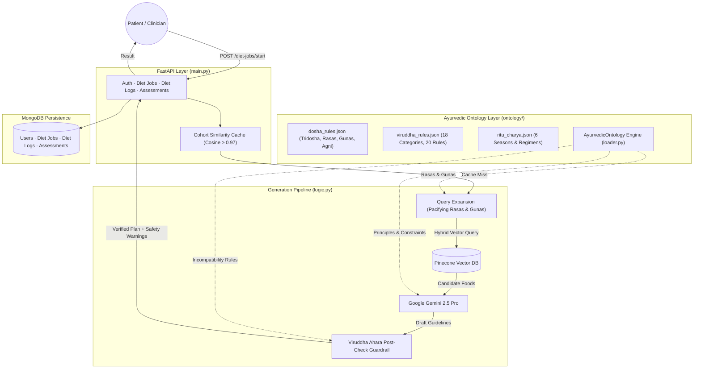

# Aayur.AI / Babayogi — Ayurvedic Wellness & Diet Generation API

Aayur.AI is an intelligent FastAPI service that generates personalized, clinically grounded Ayurvedic diet and wellness plans. It combines **Retrieval-Augmented Generation (RAG)** using Pinecone and Google Gemini 2.5 Pro with a **deterministic Ayurvedic Knowledge Ontology** (Tridosha, Shad-Rasa, Vimshati Guna, Chaturvidha Agni, Ritucharya, and Viruddha Ahara safety rules).

---

## ✨ Features

- **Personalized Ayurvedic Profiles**: Generates tailored dietary guidance based on Prakriti (baseline constitution), Vikriti (current dosha imbalance), Agni (digestive fire), allergies, season, and cuisine preference.
- **Classical Ayurvedic Ontology**: Deterministic knowledge layer encoding Tridosha, Shad-Rasa (6 tastes with numeric dosha effects), Vimshati Guna (20 qualities), Chaturvidha Agni, Sapta Dhatu, and 6 Dvandvaja Prakriti types.
- **Viruddha Ahara Safety Guardrails**: Automatically inspects generated meals for classical food incompatibilities (e.g. heated honey, equal honey + ghee, milk + fish, milk + citrus) across Charaka's 18 incompatibility categories.
- **Enhanced Vector Retrieval (RAG)**: Uses Pinecone (`ayurvedic-foods-v2` index) queried with ontology-enriched semantic embeddings (`gemini-embedding-001`) and allergy metadata filtering (`$nin`).
- **Cohort Profile Caching**: Cosine similarity matching ($\ge 0.97$) on normalized Prakriti/Vikriti/Agni ratio vectors to deduplicate identical cohorts, speeding up responses and reducing LLM inference costs.
- **Full Auth & Persistence**: MongoDB integration for JWT & Google OAuth authentication, async diet generation job queues, meal adherence logging, and assessment tracking.
- **Self-Verifying**: Built-in CLI test runner (`python -m ontology.verify`) validating ontology schema contracts and cross-reference integrity.

---

## 🏛️ System Architecture



---

## 🛠️ Tech Stack

- **Framework**: Python 3.11+, FastAPI, Uvicorn, Pydantic v2
- **Vector Retrieval**: Pinecone Vector Database
- **Generative AI & Embeddings**: Google Gemini 2.5 Pro (`gemini-2.5-pro`), Gemini Embeddings (`models/gemini-embedding-001`)
- **Database & Persistence**: MongoDB (PyMongo) with compound indexes
- **Authentication**: Custom JWT (PyJWT, PBKDF2-HMAC password hashing) + Google OAuth (google-auth)
- **Knowledge Verification**: Pydantic v2 schema validators, token-matching Viruddha Ahara engine

---

## 📁 Repository Structure

```
backend/babayogi/
├── main.py                     # FastAPI application endpoints, auth & job dispatching
├── logic.py                    # RAG orchestrator, query enrichment & safety guardrails
├── requirements.txt            # Python dependencies
├── vercel.json                 # Vercel serverless deployment configuration
├── CHECKLIST.md                # Implementation progress checklist
│
├── ontology/                   # Ayurvedic Knowledge Ontology System
│   ├── __init__.py             # Exports AyurvedicOntology query class
│   ├── dosha_rules.json        # 32 KB: Tridosha, Shad-Rasa, Vimshati Guna, Agni, Dhatus
│   ├── viruddha_rules.json     # 20 KB: Incompatible food rules with citations & aliases
│   ├── ritu_charya.json        # 17 KB: 6 seasons, ayana cycles & dietary regimens
│   ├── schema.py               # Pydantic v2 validation models for all concepts
│   ├── loader.py               # Runtime query interface & context builder
│   ├── verify.py               # Standalone verification test runner
│   └── foods/
│       └── __init__.py         # Food dataset documentation (Pinecone backed)
│
└── mds/                        # Architectural specifications & tracking
    ├── CHECKLIST.md            # Detailed implementation checklist
    ├── gap-analysis.md         # Clinical RAG gap analysis vs reference architecture
    └── implementation-plan01.md# Full multi-phase implementation roadmap
```

---

## 🚀 Getting Started

### Prerequisites

- Python 3.11 or higher
- A Google Gemini API key
- A Pinecone API key with the `ayurvedic-foods-v2` index populated
- A MongoDB cluster connection string

### 1. Environment Configuration

Create a `.env` file in `backend/babayogi/`:

```env
GEMINI_API_KEY=your_gemini_api_key_here
PINECONE_API_KEY=your_pinecone_api_key_here
PINECONE_INDEX_NAME=ayurvedic-foods-v2

MONGODB_URI=mongodb+srv://<user>:<password>@cluster.mongodb.net/?retryWrites=true&w=majority
MONGODB_DB_NAME=ayurvarta

JWT_SECRET=your-secure-random-secret
JWT_EXPIRY_HOURS=168
GOOGLE_CLIENT_ID=your_google_client_id_optional
CORS_ORIGINS=http://localhost:3000,http://localhost:5173
```

### 2. Install Dependencies

```bash
pip install -r requirements.txt
```

### 3. Verify Ontology System

Run the ontology verification suite before starting the server:

```bash
python -m ontology.verify
```

Expected output:
```
=== AyurVarta Ayurvedic Ontology Verification ===
1. Schema Validation (Pydantic v2)
  [PASS] dosha_rules.json matches schema
  [PASS] viruddha_rules.json matches schema
  [PASS] ritu_charya.json matches schema

2. Semantic & Cross-Reference Checks
  [PASS] All Dosha pacifying/aggravating rasas resolve against 6 Shad-Rasas
  [PASS] All English season mappings resolve to valid Ritus
  [PASS] All 12 month-to-ritu mappings resolve to valid Ritus
  [PASS] Loaded 20 Viruddha Ahara rules (3 critical, 3 high)

3. Runtime Query Sanity Tests
  [PASS] Viruddha check correctly detects honey + ghee combination
  [PASS] Viruddha check correctly detects milk + fish combination
  [PASS] Season resolution: 'winter' -> ['hemanta', 'shishira']
  [PASS] build_context() generates complete and coherent ontology context for LLM

All ontology checks PASSED! System is coherent and ready.
```

### 4. Run the API Server

```bash
uvicorn main:app --reload --port 8000
```

- API Base: `http://localhost:8000`
- Interactive Swagger Docs: `http://localhost:8000/docs`
- Redoc Documentation: `http://localhost:8000/redoc`

---

## ⚙️ Key Endpoints

| Method | Endpoint | Description | Auth Required |
|---|---|---|:---:|
| `POST` | `/auth/signup` | Register a new user | No |
| `POST` | `/auth/login` | Log in with email & password | No |
| `POST` | `/auth/google` | Sign in with Google ID token | No |
| `GET` | `/auth/me` | Fetch active authenticated user | Yes |
| `POST` | `/generate-diet-plan` | Synchronously generate Ayurvedic diet plan | No |
| `POST` | `/diet-jobs/start` | Queue an async diet generation job | Yes |
| `GET` | `/diet-jobs/{job_id}` | Poll diet plan generation job status | Yes |
| `GET` | `/diet-jobs/latest` | Retrieve latest generated diet job | Yes |
| `POST` | `/diet-logs` | Record meal adherence (1-5 scale) | Yes |
| `GET` | `/diet-logs` | Retrieve user meal history | Yes |
| `POST` | `/assessments` | Save Prakriti / Vikriti / Agni assessment | Yes |
| `GET` | `/assessments/latest` | Fetch user's latest assessment results | Yes |

---

## 📖 Further Reading

- [Implementation Checklist](CHECKLIST.md)
- [Gap Analysis vs Reference Clinical RAG](mds/gap-analysis.md)
- [Multi-Phase Implementation Plan](mds/implementation-plan01.md)
